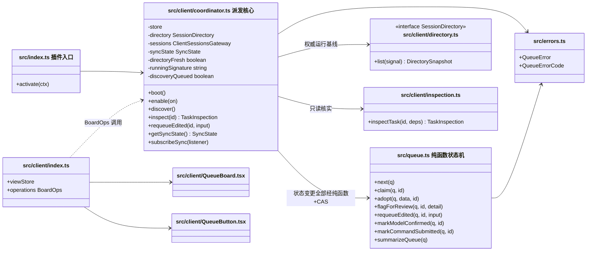
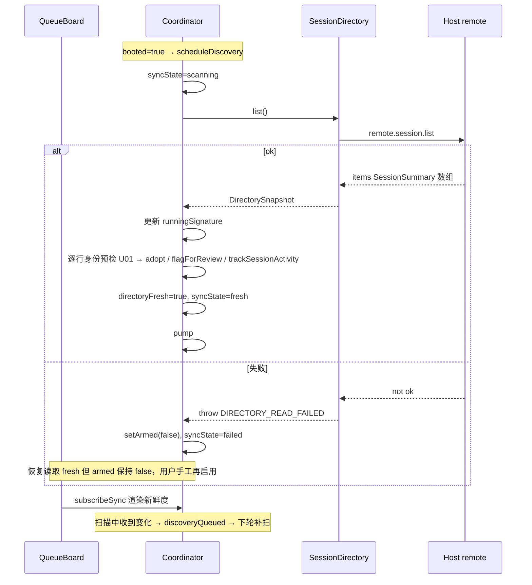
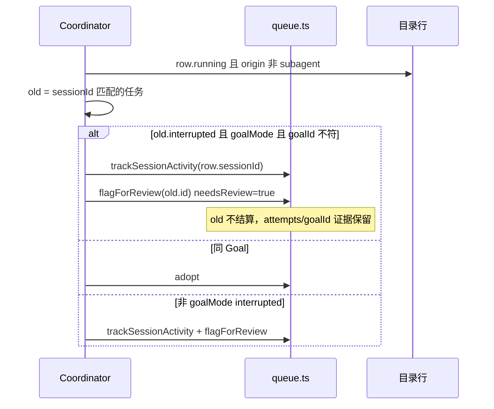
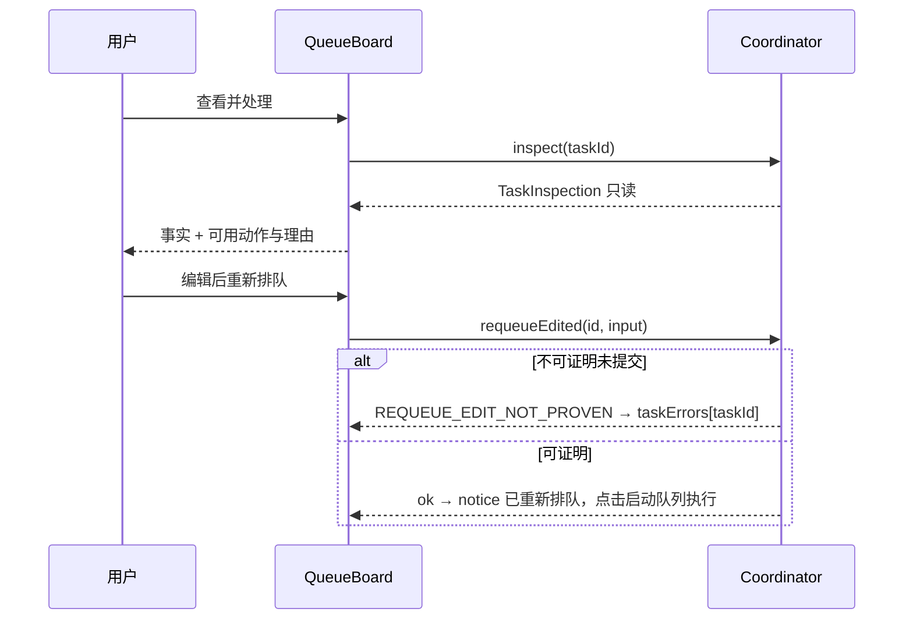
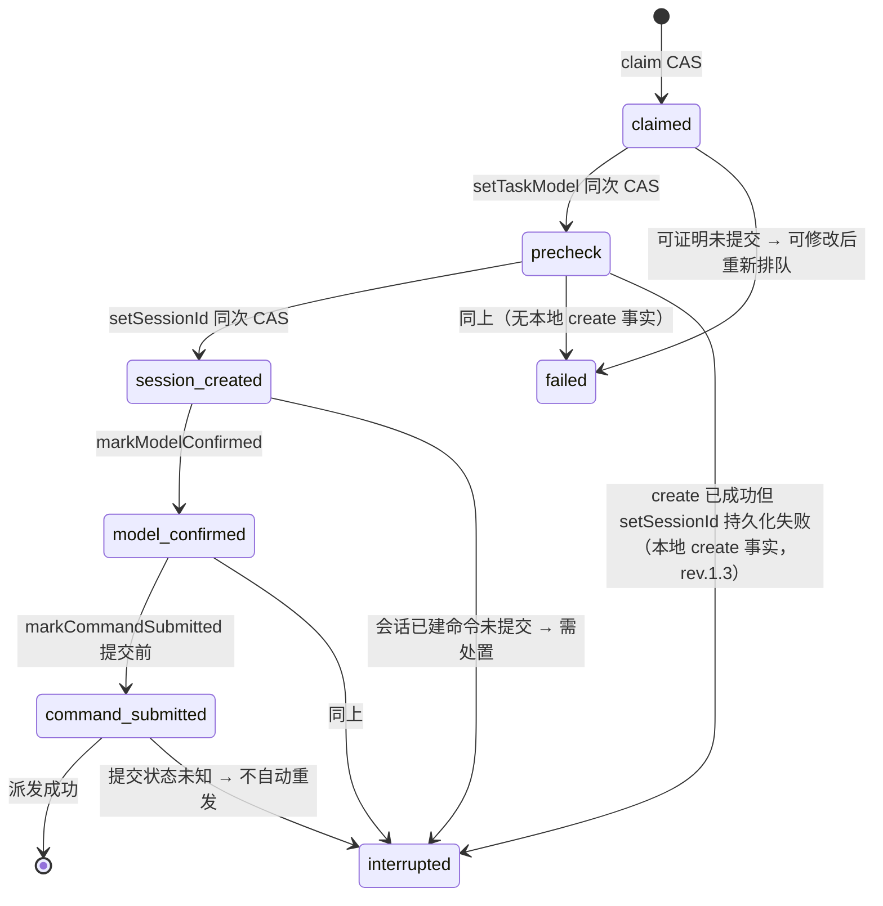

# 系统设计文档 — dsh-goal-queue U01–U13 变更实施

- 版本：1.4（2026-10-25；rev.1.4：OBS-12 裁定——模型副作用提示认可现文案「派发时设置模型也会更新 Host 默认模型…」，design 引句对齐；rev.1.3：OBS-9/10/11 裁定——§8.4 状态图失败边按语义区分 failed/interrupted、U07 节补「同次派发可叠加本地 create 事实」口径、动作文案对齐权威命名「修改后重新排队」；rev.1.2：OBS-7 裁定——`GoalGateway` 措辞改为「不得引入持久 retain/claim/写入」，瞬时 retain 读投影即口径；rev.1.1：修正 U06 动作命名以对齐清单 §5 对照表与 PRD US-06、补 `GoalGateway` 契约、注明 `attempt.phase` schema 提前至 U06 落地）
- 上游：`docs/prd.md`（产品经理）、`docs/项目优化分析与变更清单_2026-10-24.md`（需求基线）
- 基线：分支 main，HEAD `69b675f`，版本 0.3.2-preview.0，适配 DPH v0.2.1-rc.2
- 下游：`docs/tasks.md`（项目经理）
- 补充需求：U13 串行派发（并发上限=1），Chief 2026-10-24 转达老板需求，实施次序排入 U04/U05 同阶段

## 1. 背景

dsh-goal-queue 是 DPH 的 Cordis 插件（入口 `src/index.ts`，客户端逻辑 `src/client/`），为 Goal 提供持久任务队列：串行派发、Session 观察、标题生成。变更清单 R01–R07 定位了 7 类缺陷（发现不触发、旧基线可信、时序缺口、错误态污染、Goal 身份覆盖、外部活动误判、告警生命周期），对应变更 U01–U12；老板新增 U13（并发上限固定 1）。

本插件没有自有 REST API。本文的"API"指两类一等契约：① 模块公开接口（`queue.ts` 纯函数、`Coordinator` 类、客户端 `viewStore`）；② DPH SDK 公开契约的使用方式（已对照已安装 SDK 的 d.ts 核实）。QA 按同一张表写契约测试。

## 2. 技术选型

| 项 | 选择 | 理由 |
|---|---|---|
| 语言 | TypeScript ^5.9.2，ESM，strict | 沿用现状 |
| 构建 | tsdown ^0.22.2 | 沿用现状 |
| 测试 | `node --experimental-strip-types --test test/*.test.ts` | 沿用现状，不新增依赖 |
| 类型检查 | `npm run typecheck` = `tsc --noEmit` | 沿用现状 |
| 运行时依赖 | 零新增；peerDeps 全部钉 `0.2.1-rc.2` | 边界 B6 不改 DPH，避免版本漂移 |
| UI | 现有 React（`src/client/*.tsx`）+ 内联样式（styles.ts） | 沿用现状 |
| 新增模块 | `errors.ts` / `client/directory.ts` / `client/inspection.ts` | 可测性（依赖注入假目录源）与信任边界收敛 |

选型原则：**零新增运行时依赖**。新模块只为测试接缝与信任边界存在，不引入框架。

## 3. 总体架构



不变式（全部新代码必须维持）：
1. 所有队列状态变更经 `queue.ts` 纯函数 + store CAS 写入；Coordinator 不直接改字段。
2. 运行事实只信两个来源：`remote.session.list`（权威基线）与既有 session hold 的 stop 事件（本次执行边界证据）。
3. 客户端 manager 的 `getSnapshot().byId` 行仅用于标题同步与 retain，**禁止访问 `getSnapshot().state`**（私有）。
4. 执行证据（attempts / sessionId / goalId / detail / phase）只追加与归档，任何新逻辑不删除（B3）。

## 4. 数据模型与迁移

### 4.1 类型与字段（src/client/models.ts、src/queue.ts）

新增导出类型：

```ts
export type DispatchPhase =
  | 'claimed' | 'precheck' | 'session_created' | 'model_confirmed' | 'command_submitted'
```

字段变更（全部可选，旧数据可直接读）：

| 载体 | 字段 | 变更 | 关联 |
|---|---|---|---|
| Task | `phase?: DispatchPhase` | 当前 attempt 阶段镜像 | U07 |
| Task | `needsReview?: boolean` | 身份/边界待人工核实标记 | U01 |
| Task | `titleError?: string` | 任务级标题失败（claim 时归档进上一 attempt） | U05 |
| TaskAttempt | `phase?: DispatchPhase` | 该次执行的阶段 | U07 |
| TaskAttempt | `titleError?: string` | 该次执行的标题失败 | U05 |
| QueueState | `maxConcurrent` | 语义收敛：恒为 1（见 U13），字段保留兼容 | U13 |

### 4.2 迁移策略

- 无版本号迁移：新字段全部可选；`settings-schema.ts` 与 `queue.ts` 的 decode 对缺失字段填 `undefined`，**不伪造**（旧 attempt 的 `phase` 不得回填 `'claimed'`）。
- 旧数据 `phase === undefined`：UI 显示「阶段未知」；`requeueEdited` 拒绝（无法证明未提交）；dispatch 失败分类退回既有 detail 文案。
- `maxConcurrent` 旧值 2–8：decode 时归一为 1（见 U13），不弹错、不丢数据。

## 5. 统一错误码表（新增 src/errors.ts）

```ts
export type QueueErrorCode =
  | 'DIRECTORY_READ_FAILED' | 'NOT_BOOTED' | 'CONNECTION_CHANGED'
  | 'GOAL_IDENTITY_MISMATCH' | 'SESSION_STILL_RUNNING' | 'SESSION_NOT_FOUND'
  | 'REQUEUE_EDIT_NOT_PROVEN' | 'SUBMISSION_UNKNOWN' | 'CAPACITY_FULL'
  | 'UNRESOLVED_BLOCKING' | 'NOT_AUTHORIZED' | 'TASK_NOT_FOUND'
export class QueueError extends Error {
  readonly code: QueueErrorCode
  constructor(code: QueueErrorCode, message: string)
}
```

| 码 | 触发点 | 客户端展示（中文） | 关联 |
|---|---|---|---|
| DIRECTORY_READ_FAILED | `SessionDirectory.list` 失败 | 无法读取运行会话列表，已暂停派发 | U02/R02 |
| NOT_BOOTED | booted 前调用操作 | 插件尚未就绪，请稍后重试 | U03 |
| CONNECTION_CHANGED | 操作期间 epoch 变化 | 连接已切换，请重试 | U02/U03 |
| GOAL_IDENTITY_MISMATCH | scanRunning/adopt 身份冲突 | 该任务已标记待核实：同一会话正在运行其他 Goal | U01/R05 |
| SESSION_STILL_RUNNING | retry/remove 时会话仍运行 | 原会话仍在运行，请先处置 | 既有保留 |
| SESSION_NOT_FOUND | openSessionById 会话已不存在 | 会话已不存在 | U04 |
| REQUEUE_EDIT_NOT_PROVEN | requeueEdited 阶段不可证明 | 无法证明命令未提交，不能编辑重排队 | U07 |
| SUBMISSION_UNKNOWN | 派发失败且已提交命令 | 命令提交状态未知，不会自动重发 | U07/B1 |
| CAPACITY_FULL | 名额占用时 claimGoalResume | 当前执行名额已被占用 | U13 既有保留 |
| UNRESOLVED_BLOCKING | 有未处置任务时 enable | 存在未确认的历史任务，请先检查原 Session 并处置 | 既有保留 |
| NOT_AUTHORIZED | 未授权时派发 | （内部守卫，不上 UI） | 既有 |
| TASK_NOT_FOUND | id 不存在 | 任务已不存在 | U06 |

规则：新增 throw 点一律 `QueueError`；既有字符串错误保留原文案并逐步挂码；客户端按 code 映射文案，**不解析 message 文本**。

## 6. API 与契约定义

### 6.1 queue.ts 纯函数（签名均含 `q: QueueState`，时间参数 `now`）

| 函数 | 签名 | 变更 |
|---|---|---|
| adopt | `adopt(q, data, sessionId, now)` | interrupted 分支：`t.goalId && data.goalId && t.goalId !== data.goalId` → 原样返回 q（不覆盖不结算，防御纵深） |
| flagForReview | `flagForReview(q, taskId, detail, now)` | **新增**：置 `needsReview=true`、写 detail，不改 status |
| updateActive | `updateActive(q, ...)` | **不再写 `q.error`**（U05）；unresolved 阻断仍置 `enabled=false` |
| claim | `claim(q, id, now)` | 新 attempt 记 `phase:'claimed'`；`task.titleError` 归档进上一 attempt 后清空 |
| setTaskModel | `setTaskModel(q, id, model, phase, now)` | 增 `phase` 参，同次 CAS 写 `phase:'precheck'` |
| setSessionId | `setSessionId(q, id, sessionId, phase, now)` | 增 `phase` 参，同次 CAS 写 `phase:'session_created'` |
| markModelConfirmed | `markModelConfirmed(q, id, now)` | **新增**：写 `phase:'model_confirmed'` |
| markCommandSubmitted | `markCommandSubmitted(q, id, now)` | **新增**：提交命令前写 `phase:'command_submitted'` |
| requeueEdited | `requeueEdited(q, id, input, now)` | **新增**：仅当任务 UNRESOLVED 且最后 attempt `phase ∈ {'claimed','precheck'}` 且 `!sessionId`；否则抛 `REQUEUE_EDIT_NOT_PROVEN`。编辑 input 后回到 pending，保留 attempts |
| summarizeQueue | `summarizeQueue(q): QueueSummary` | 返回拆分形状（见下） |
| setConcurrency | — | **删除**（U13） |
| next | `next(q)` | 逻辑不变；容量守卫 `activeIds+sessionActivity >= maxConcurrent` 因 maxConcurrent≡1 成为串行闸门 |

```ts
export interface QueueSummary {
  unresolved: number
  pending: number
  starting: number          // 队列内已 claim 未观察到运行
  observedRunning: number   // 自有任务被观察到运行
  externalActivity: number  // sessionActivity（外部会话活动）
  occupied: number          // activeIds ∪ sessionActivity 去重计数
}
```

### 6.2 Coordinator 公开接口（src/client/coordinator.ts）

| 方法 | 入参 | 出参 | 说明 |
|---|---|---|---|
| boot | — | Promise<void> | 初始化；`booted=true` 后自动安排首次只读发现（U03） |
| enable | `on: boolean` | Promise<void> | 前置由 `discovered` 改为 `directoryFresh`；抛 NOT_BOOTED / UNRESOLVED_BLOCKING / CONNECTION_CHANGED |
| discover | — | Promise<void> | 手动刷新，复用 scanRunning；扫描中合并（discoveryQueued） |
| inspect | `id: string` | Promise<TaskInspection> | **新增**：只读核实（U06），零写入 |
| requeueEdited | `id: string, input: TaskInput` | Promise<void> | **新增**：包装 queue.requeueEdited，epoch/connected 校验 |
| getSyncState | — | SyncState | **新增** |
| subscribeSync | `listener: () => void` | `() => void` | **新增**：同步状态变更订阅 |
| setConcurrency | — | — | **删除**（U13） |

```ts
export type SyncState =
  | { state: 'initializing' }
  | { state: 'scanning'; startedAt: number }
  | { state: 'fresh'; syncedAt: number }
  | { state: 'failed'; reason: string; failedAt: number }
```

内部关键改动：
- `discovered: boolean` → `directoryFresh: boolean`（connectionReset 置 false）。
- `runningSignature: string`：上次可信快照中 running 且非 subagent 的 sessionId 排序签名；变化 → `scheduleDiscovery()`。
- `scheduleDiscovery()`：scanning 中 → `discoveryQueued=true`；本轮扫描完成后若 discoveryQueued → 再扫一轮（变化不丢）。
- `sessions.list.subscribe`：`syncTitles()` + 签名比对（修 R01）。
- scanRunning 失败：`setArmed(false)` + syncState=failed；**恢复读取成功不恢复 armed**（B1 不自动重跑，用户手工再启用）。
- pump 的 `while(armed)` 结构不变：claim 串行 + `next()` 容量守卫（maxConcurrent≡1）即满足 U13。

### 6.3 SessionDirectory（新增 src/client/directory.ts）

```ts
export interface DirectoryRow {
  sessionId: string
  running: boolean
  origin?: 'subagent'
  cwd?: string
  updatedAt: number
}
export interface DirectorySnapshot { rows: readonly DirectoryRow[]; syncedAt: number }
export interface SessionDirectory { list(signal?: AbortSignal): Promise<DirectorySnapshot> }
```

`HostSessionDirectory` 实现：
1. `const r = await ctx.remote.session.list({}, signal)`
2. `!r.ok` → 抛 `QueueError('DIRECTORY_READ_FAILED', ...)`
3. `r.value.items` 映射为 `DirectoryRow[]`，`syncedAt = Date.now()`
4. `SessionSummary` **无 title 字段**：标题仍由 `syncTitles()` 从客户端 manager 公开 `list` 的 byId 行同步（best-effort）；缺标题显示「未命名任务/未命名目标」（产品经理已确认口径）。
5. `sessions.refresh()` 降级 best-effort：失败不影响权威基线，只影响标题/retain。
6. 测试注入假 `SessionDirectory`（ok→fail→ok 序列）。

### 6.4 TaskInspection（新增 src/client/inspection.ts）

```ts
export interface TaskInspection {
  taskId: string
  sessionFound: boolean
  sessionRunning: boolean
  goalIdMatches: boolean | null   // null = 非 goal 模式或无 goalId
  canResume: boolean
  canRetry: boolean
  canSkip: boolean
  canRequeueEdited: boolean
  reasons: Partial<Record<'resume'|'retry'|'skip'|'requeueEdited', string>>
  warnings: string[]
}
export interface GoalGateway {
  /** 只读：取该 Session 自身 goal 投影；无 Goal 返回 null。零写入、不占执行名额、不引入持久 retain。 */
  goalOf(sessionId: string): Promise<{ id: string; phase?: string } | null>
}
export function inspectTask(id: string, deps: {
  queue: () => QueueState
  directory: SessionDirectory
  goals: GoalGateway
}): Promise<TaskInspection>
```

（rev.1.1：`GoalGateway` 为工程师按本节需要自定的最小只读接口，架构师确认并入契约——实现走既有 `session.projections.faceOf('goal')` 读取，不得引入写入、claim 或持久 retain。）

（rev.1.2 · OBS-7 裁定：读投影本身需要 retain 才能取到 face，故契约口径为「不得引入**持久** retain/claim/写入」——瞬时 retain→读投影→立即释放（不跨调用持有、不入队列名额账）即符合口径，工程师现实现即正确口径。）

只读：读目录快照 + 队列 + goal 投影；不写状态、不 claim。`canRequeueEdited` 复用 6.1 的可证明条件。

### 6.5 viewStore（src/client/index.ts）

```ts
interface ViewState {
  open: boolean
  error: string                       // 全局状态提示（语义收窄，见 U05）
  notice: string                      // 处置后「下一步」提示（U06）
  formErrors: Record<string, string>  // 表单字段 id → 错误（U05/U10）
  taskErrors: Record<string, string>  // taskId → 错误（U05）
}
```

错误路由：表单 op 失败 → `formErrors`；任务行 op 失败 → `taskErrors[taskId]`；系统级（连接/设置）→ `error`。`q.error` 渲染为状态提示条而非 alert；仅 `settings.status === 'error'`（Host 不可信）阻断操作（R04 验收）。

### 6.6 DPH SDK 公开契约使用表（已对照 d.ts 核实）

| SDK 接口 | 用途 | 契约要点 |
|---|---|---|
| `ctx.remote.session.list({}, signal?)` | 权威运行基线（U02） | 返回 `RemoteResult<SessionListValue>`；`SessionListValue = { items: readonly SessionSummary[] }`；`SessionSummary = { agentAvailable, formatStatus?, sessionId, updatedAt, running, blank, parentSessionId?, origin?: 'subagent', cwd?, projections? }`；**无 title 字段**；`SessionListRequest = { cursor?: string }` |
| 客户端 sessions manager（`sessions.list.subscribe` / `getSnapshot().byId`） | 标题同步、retain（best-effort） | 禁止访问 `getSnapshot().state`（私有） |
| session hold + `projections.faceOf('goal')`（既有 hold/observe） | 本次执行边界证据、Goal 投影 | 沿用现状，不改 |

## 7. 各变更实现逻辑

### U01 Goal 身份保护（R05）
文件：`queue.ts`（adopt、flagForReview）、`client/coordinator.ts`（scanRunning）、`client/models.ts`（needsReview）
- scanRunning 在 adopt 前预检：goalMode 且 `old.goalId` 与行投影 goal.id 均存在且不等 → **不 adopt**；`trackSessionActivity(id)` + `flagForReview(old.id, '同一会话正在运行其他 Goal（id 不符），原任务证据保留，请人工核实')`。
- goalMode 同 Goal（或 old.goalId 缺失）→ 照旧 adopt（goalId 取投影）。
- 非 goalMode 的 interrupted：不再自动 adopt 结算（无本次执行边界证据）→ trackSessionActivity + flagForReview（文案「原会话仍在运行，缺少本次执行边界证据，请人工核实」）。
- adopt 内部防御纵深：goalId 冲突原样返回 q。
- 验收映射：R05 链——Goal A interrupted → 同会话跑 B → B 完成 → A 未结算、证据完整、needsReview 标记。

### U02 可信目录基线（R02）
文件：新增 `client/directory.ts`、`client/coordinator.ts`
- scanRunning 第一步 `directory.list()` 为权威基线；失败 → DIRECTORY_READ_FAILED + `setArmed(false)` + syncState=failed。
- 移除 `snapshot.phase === 'ready'` 单一判据 → `booted && connected && settings ready`。
- `sessions.refresh()` best-effort。恢复读取成功 → syncState=fresh 但 armed 保持 false。
- 验收映射：R02 链——目录读 ok→fail→ok；失败期间无新派发；恢复不自动重跑。

### U03 发现调度（R01/R03）
文件：`client/coordinator.ts`、`client/QueueBoard.tsx`
- `booted=true` → pump → `scheduleDiscovery()`（首次只读发现，不依赖面板打开）。
- `sessions.list.subscribe` → syncTitles + runningSignature 比对 → 变化触发 scheduleDiscovery。
- 扫描中收到变化 → discoveryQueued 下轮补扫；connectionReset 重置 directoryFresh/runningSignature/syncState。
- Board 订阅 syncState 渲染新鲜度（fresh 时间 / scanning / failed 原因 / initializing）；保留手动「刷新运行任务」。
- 验收映射：R01（不开面板也能发现新会话）、R03（booted 后自动发现时序）。

### U04 外部活动与占用（R06）
文件：`queue.ts`（summarizeQueue）、`client/QueueButton.tsx`、`client/QueueBoard.tsx`、`client/index.ts`（新 op `openSessionById`）
- QueueSummary 拆分 starting/observedRunning/externalActivity/occupied（见 6.1）。
- QueueButton：「占用 N（启动 X · 运行 Y · 外部 Z）」。
- Board 新增「外部活动」区：列 sessionActivity，每行「打开」→ `openSessionById(sessionId)`；不存在 → SESSION_NOT_FOUND 提示。
- trackSessionActivity 去重/超限/低于下限行为不变。
- 验收映射：R06 链——旧任务删除后外部活动仍可打开；仅权威 stop 释放。

### U05 告警生命周期（R04/R07）
文件：`queue.ts`（updateActive）、`client/models.ts`（titleError）、`client/coordinator.ts`、`client/title-command.ts`、`client/index.ts`（viewStore）、`client/QueueBoard.tsx`
- updateActive 不写 q.error；标题失败写 `task.titleError`（claim 归档进上一 attempt）。
- viewStore 扩展（6.5），错误按来源绑定渲染。
- q.error 渲染为状态提示条；`settings.status==='error'` 仍阻断（Host 不可信）。
- schema 先于 U07 定稿（PRD 依赖）。
- 验收映射：R04 链（标题失败不污染全局错误条）、R07 链（告警生命周期）。

### U06 统一处理入口（R05/R06）
文件：新增 `client/inspection.ts`、`client/coordinator.ts`（inspect、requeueEdited）、`client/QueueBoard.tsx`
- 任务行单一按钮「查看并处理」→ 核实面板：事实（会话存在/运行/Goal id 匹配）+ 可用动作与理由。
- 动作命名严格按变更清单第 5 节对照表与 PRD US-06：查看原会话 / 继续原目标 / 重试此任务（新会话）/ 跳过此任务 / 修改后重新排队 / 删除记录（rev.1.1 修正：rev.1.0 误写「恢复原 Goal／编辑后重新排队」，以本表为准）。
- 去掉 `window.confirm`；处置后 notice 说明下一步（跳过→「队列仍暂停，点击启动队列继续」；重试→「已重新排队，点击启动队列执行」；恢复→「原 Goal 已恢复，占用一个执行名额」）。
- interrupted 非 goalMode 标签「待核实」；goalMode →「等待人工恢复」。
- 验收映射：U06 事件链（§7.6）。

### U07 派发阶段与可证明重排（B1/B3）
文件：`client/models.ts`（DispatchPhase）、`queue.ts`（claim/setTaskModel/setSessionId/markModelConfirmed/markCommandSubmitted/requeueEdited）、`client/coordinator.ts`（dispatch）、`client/QueueBoard.tsx`
- 阶段与既有数据同次 CAS 写入（见 6.1）；旧数据 phase=undefined 不伪造。
- rev.1.1：`attempt.phase` 字段 schema 提前至 U06（M7）落地（`requeueEdited` 可证明性判定需要），U07 只补 dispatch 各阶段写入、不动结构；legacy attempt 无 phase 一律保守拒绝。
- dispatch 失败分类（任务终态按语义区分，rev.1.3 · OBS-9）：
  - phase ∈ {claimed, precheck} 且无 sessionId 且无本地 create 事实 → 任务 `failed`，「已确认未提交，可修改后重新排队」
  - phase ∈ {session_created, model_confirmed} → 任务 `interrupted`，「会话已创建、命令未提交，需处置原会话」
  - phase = command_submitted → 任务 `interrupted`，「命令提交状态未知，保守处理，不会自动重发」（挂 `SUBMISSION_UNKNOWN` 码）
- rev.1.3 · OBS-10：同次派发内可叠加本地 create 事实——`sessions.create()` 成功但 `setSessionId` 持久化失败时，持久 phase 停在 precheck，但本地确知 Session 已建（孤儿 Session 需处置，对应 B2），此时按「会话已创建」分类、任务记 `interrupted`，不得按 claimed/precheck 放行重排。
- `SUBMISSION_UNKNOWN` 等派发分类码的口径（rev.1.3 · OBS-11）：错误码挂在抛错/分类对象上供程序判定与测试断言；UI 展示人读文案（failure detail），不要求渲染码本身——现实现即口径。
- 「修改后重新排队」仅在 `canRequeueEdited` 时出现（rev.1.3 对齐权威命名）。
- 验收映射：U07 链（§7.7）。

### U08 工作区显式选择（R07）
文件：`client/index.ts`（newForm）、`client/QueueBoard.tsx`
- `newForm()` 默认 `workspaceId = ''`（不再默认 `workspaces.items[0]`）。
- 实现步骤需核验 uiWorkspace 公开 API 能否确认当前工作区；**不能确认则要求显式选择**（保存校验 `formErrors.workspace='请选择工作区'`）。
- 保存按钮按授权态文案：authorized+enabled →「加入运行中的队列」（提示「加入后将按可用名额执行」）；authorized+enabled+pending=0 →「等待新任务，加入后执行」；其余 →「保存任务」。
- 验收映射：R07 链工作区部分。

### U09 标题三模式（B4）
文件：`client/QueueBoard.tsx`、`client/settings.ts`、`title-policy.ts`
- 单选：留空（none）/ 手动（manual）/ AI 生成（ai）；none/manual 均映射 `generateTitle=false`；ai → true。
- 模式切换保留草稿（titleDraft 状态）；`titleMaxChars` 移入「高级选项」折叠区。
- 缺标题显示：goalMode ? 「未命名目标」 : 「未命名任务」。
- 验收映射：B4 不默认增加标题模型请求。

### U10 表单顺序与局部错误
文件：`client/QueueBoard.tsx`
- 顺序：任务说明 → 工作区 → 执行方式 → 模型与推理 → 标题 → 高级选项。
- 字段错误内联（formErrors）；模型副作用一行提示「派发时设置模型也会更新 Host 默认模型；恢复已有 Session 不重新设置模型。」（rev.1.4 · OBS-12 裁定：认可现文案——「派发时」更贴插件术语，design 引句同步对齐。）
- 超长提示：「任务内容过长，无法再生成标题；可关闭 AI 标题后保存」（不建议删正文）。
- 实现术语（CAS/投影/token/UTF-16）移入 help/details。

### U11 Board 信息分层
文件：`client/QueueBoard.tsx`、`client/index.ts`
- 顶部：授权态、占用拆分、待执行、未处置（点击→筛异常）、同步新鲜度。
- 主操作：blockers>0 →「处理 N 项异常」；否则 →「启动队列」。
- 行：标题、工作区、状态、原因、主操作；次操作入「更多」；筛选按钮带计数；顶部提示「暂停只停止派发，已在运行的任务继续」。
- 键盘/焦点/Escape/焦点归还由 U12 实机验证。

### U13 串行派发（并发上限=1）【新增需求】
文件：`settings-schema.ts`、`queue.ts`、`client/coordinator.ts`、`client/QueueBoard.tsx`
- **schema**：`maxConcurrent: z.number().step(1).min(1).max(8).default(1)` → `z.number().default(1).transform(() => 1)`。旧数据 2–8 归一为 1，不弹错不丢数据；字段保留（兼容 + 容量守卫）。
- **queue.ts**：删除 `setConcurrency`；`EMPTY_QUEUE.maxConcurrent=1` 不变；`next()` 与 `claimGoalResume` 的容量守卫（`activeIds+sessionActivity >= maxConcurrent`）保留——maxConcurrent≡1 即串行闸门：同一时刻至多 1 个执行名额（自有 active 任务或外部观察会话）。
- **coordinator**：删除 `setConcurrency` 方法；pump 的 `while(armed)` 结构不变——claim 串行 + 容量守卫已保证并发=1，不重写循环。
- **UI**：移除「最大并发」下拉（QueueBoard:130）；busy 提示改为「串行模式：至多 1 项占用执行」；超上限警告（发现的运行任务 > 上限）保留——外部会话可能 >1，不强制结束、不派发新任务。
- **与 U04/U06 关系**：占用来源拆分（starting/observedRunning/externalActivity）不变，occupied 语义不变；「继续原目标」经 claimGoalResume 占用唯一名额，名额被占 → CAPACITY_FULL 提示「当前执行名额已被占用」。
- 验收映射（Chief 给的验收例）：多任务待执行时启动队列 → 仅第一个进入运行；其结束（完成/失败处置释放名额）后下一个才可被派发；任何时刻不得两个任务同时占用 Session 执行。

## 8. 关键时序图与状态图

### 8.1 U02+U03 可信发现



### 8.2 U01 Goal 身份冲突



### 8.3 U06 处理入口



### 8.4 U07 派发阶段状态机



## 9. 项目文件结构（★=新增，其余为修改）

```
dsh-goal-queue/
├── package.json                  # 不变（零新增运行时依赖）
├── tsconfig.json                 # 不变
├── docs/
│   ├── prd.md                    # 已有（产品经理将补 U13）
│   ├── design.md                 # 本文档
│   ├── tasks.md                  # 项目经理输出
│   ├── qa.md                     # 质量QA输出
│   └── 项目优化分析与变更清单_2026-10-24.md
├── src/
│   ├── index.ts                  # 插件入口，基本不变
│   ├── queue.ts                  # adopt/flagForReview/updateActive/claim/setTaskModel/
│   │                             # setSessionId/markModelConfirmed/markCommandSubmitted/
│   │                             # requeueEdited/summarizeQueue；删 setConcurrency
│   ├── errors.ts                 # ★ QueueErrorCode + QueueError
│   ├── settings-schema.ts        # 新可选字段 decode；maxConcurrent transform→1
│   ├── model-policy.ts           # 不变
│   ├── title-command.ts          # 失败写 task.titleError 而非 q.error
│   ├── title-policy.ts           # U09 映射：none/manual→generateTitle=false
│   └── client/
│       ├── index.ts              # viewStore 扩展；newForm workspaceId=''；新 op openSessionById
│       ├── coordinator.ts        # SyncState/directoryFresh/runningSignature/discoveryQueued/
│       │                         # inspect/requeueEdited/scanRunning 重构；删 setConcurrency
│       ├── directory.ts          # ★ SessionDirectory 接口 + HostSessionDirectory 实现
│       ├── inspection.ts         # ★ inspectTask 只读核实
│       ├── models.ts             # DispatchPhase；Task/Attempt 新可选字段
│       ├── observe-task.ts       # 不变
│       ├── queue-view.ts         # 标签/摘要渲染适配
│       ├── settings.ts           # U09 标题三模式；titleMaxChars 入高级选项
│       ├── store.ts              # 不变
│       ├── styles.ts             # 新区块样式
│       ├── QueueButton.tsx       # 占用拆分显示
│       └── QueueBoard.tsx        # U03/U04/U05/U06/U08/U09/U10/U11/U13
└── test/
    ├── （既有 10 个文件）         # 保留；适配签名变化
    ├── directory-trust.test.ts        # ★ §7.1（R02）
    ├── discovery-scheduling.test.ts   # ★ §7.2（R01/R03）
    ├── goal-identity.test.ts          # ★ §7.3（R05）
    ├── alert-lifecycle.test.ts        # ★ §7.4（R04/R07）
    ├── session-activity.test.ts       # ★ §7.5（R06）
    ├── board-interactions.test.ts     # ★ §7.6（U06/U08/U09/U10/U11）
    ├── dispatch-phase.test.ts         # ★ §7.7（U07）
    └── serial-dispatch.test.ts        # ★ U13 串行验收链
```

## 10. 测试设计（新增 8 个文件，映射 PRD §7 + U13）

| 新文件 | 链 | 核心断言 |
|---|---|---|
| directory-trust | §7.1 | 假 SessionDirectory ok→fail→ok；失败期间无新派发；恢复后 armed 仍 false；enable 需 directoryFresh；代码不引用 `getSnapshot().state` |
| discovery-scheduling | §7.2 | booted 触发首次发现（面板未开）；runningSignature 变化触发合并发现；扫描中 discoveryQueued 补扫；subagent 排除；connectionReset 重置 |
| goal-identity | §7.3 | A interrupted→B 跑→B 完成→A 未结算；needsReview；attempts/goalId 证据完整；同 Goal adopt 保留；非 goal interrupted 不自动结算 |
| alert-lifecycle | §7.4 | updateActive 不写 q.error；titleError 绑任务并在 claim 归档进 attempt；settings.status==='error' 仍阻断 |
| session-activity | §7.5 | 旧任务删除后外部活动仍可 openSessionById；仅权威 stop 释放；去重/超限/下限不变 |
| board-interactions | §7.6 | 动作命名对照表；无 window.confirm；notice 下一步；工作区默认空需显式选择；保存按钮文案；标题三模式草稿保留 |
| dispatch-phase | §7.7 | phase 同次 CAS 持久化；requeueEdited 仅 phase∈{claimed,precheck} 且无 sessionId；command_submitted 失败不重发；旧数据 phase=undefined 不伪造 |
| serial-dispatch | U13 | 旧数据 maxConcurrent=3 归一为 1；一个名额被占时 next() 返回 undefined；claimGoalResume 占用后抛 CAPACITY_FULL；多 pending 启动后仅第一个 claim；释放后第二个才 claim；schema 无并发配置入口（setConcurrency 已删） |

既有 96 项测试：适配 `setTaskModel`/`setSessionId` 增参、`summarizeQueue` 返回形状、`setConcurrency` 删除；断言语义不变。

## 11. 补充准备与依赖

1. **SDK 契约已核实**（见 6.6）。`SessionSummary` 无 title → 标题路径不变（syncTitles best-effort + 「未命名」兜底），产品经理已确认。
2. **uiWorkspace 当前工作区**：公开 API 能否读取待实现时核验（U08 唯一外部核验项）；不能确认则兜底显式选择（默认空）。
3. **schema 次序**：U05（titleError）先于 U07（phase）定稿（PRD 依赖）。
4. **实施次序**（Chief 指定）：U01→U02→U03→U04/U05/U13→U06/U07/U08→U09/U10/U11→U12；每次只做一个可验收变更。U01 是 U03/U06 身份前提；U02 是 U03/U05 可信性前提；U13 与 U04 同阶段（占用语义一次定稿）。
5. **边界 B1–B6 落点**：不自动重跑（恢复不恢复 armed；command_submitted 不重发）；不默默跳过（全部失败有错误码 + UI 绑定）；不删证据（flagForReview/retry 保留 attempts）；不默认加标题请求（U09）；不声称跨 Client 全局并发（UI 文案避免「全局」，U13 文案「至多 1 项占用执行」）；不改 DPH 内置代码（零新增依赖，peerDeps 钉死）。
6. **U12 实机项**（验收前单独列给老板确认）：真实 Desktop 安装/加载、真实 Host 发现与派发、多工作区含中文路径、键盘/焦点/Escape/窄窗、R03 时序、串行派发实机观察（多任务仅一个运行）。

## 12. 交接说明

- 项目经理：按 U01–U13 + 第 9 节文件结构 + 第 10 节测试设计拆任务；每项完成条件 = PRD 验收标准 + 第 7 节验收映射。
- 工程师：第 6 节 API 表与第 5 节错误码表为契约，签名与码名不得自改；第 9 节文件树可照抄。
- 澄清通道：需求问题找产品经理，技术设计问题找架构师。
